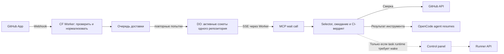

# Архитектура доставки GitHub-событий для ожидания CI

Статус: архитектура уточнена: MCP-задача владеет CI wait; relay и событийное подключение MCP реализованы локально, сквозное развёртывание ещё не выполнено.
Связанный [эпик](ci-event-wait-epic.md).

Решение владельца: один общий webhook endpoint принимает и передаёт сообщения. MCP-метод владеет selector-ом, ожиданием и CI-вердиктом. Обычный локальный сценарий завершается возвратом результата инструмента, который продолжает OpenCode agent. Control panel и Runner API не участвуют; если другой host использует parked tasks, ему достаточно узкого task lifecycle signal. До реализации такого внешнего сценария контракт нужно проверить.

## 1. Компоненты и ответственность



| Компонент | Владеет |
|---|---|
| GitHub App | Установками, разрешёнными репозиториями и одной конфигурацией webhook |
| CF event relay | Проверкой GitHub подписи, форматом сообщения, доставкой, retry и диагностикой доставки; DO даёт эфемерный fan-out активным соединениям |
| MCP wait method | Selector-ом, активными ожиданиями, CI-вердиктом, дедлайном и reconciliation через GitHub API |
| Control panel backend | Не участвует в локальном MCP CI wait; при внешнем parked-task runtime может принять узкий сигнал task lifecycle |
| Runner API | Приёмом команды продолжения, состоянием запуска, исполнением агента и результатом |
| MCP adapter | Вызовом wait method и выдачей результата через протокол host |

Relay не хранит ожидания задач и не вычисляет CI-вердикт. DO группирует только живые соединения по репозиторию и рассылает им событие; MCP сопоставляет его с активным вызовом. Control panel не является GitHub inbox или менеджером подписок.

**Durable Object нужен как WebSocket event channel, потому что локальный stdio MCP не имеет входящего endpoint-а.** Один объект на репозиторий хранит только bounded event cursor log и активные соединения; task/wait state там нет. Hibernation сохраняет соединения без billable duration charge во время простоя. Задокументированный предел — 32,768 WebSocket connections на объект; практический предел может быть ниже из-за CPU/memory. Перед включением проверим нагрузку; канал можно шардировать. См. [WebSocket hibernation](https://developers.cloudflare.com/durable-objects/best-practices/websockets/) и [лимиты DO](https://developers.cloudflare.com/durable-objects/platform/limits/).

## 2. Минимальная инфраструктура relay

Один Worker deployment с HTTP handler, Queue consumer и DO class. Queue с DLQ переживает краткий outage; DO раздаёт события активным SSE подписчикам. Ни очередь, ни DO не управляют агентами.

Worker отвечает GitHub 2xx только после подтверждённой записи нормализованного сообщения в очередь. Consumer рассылает событие через DO и подтверждает сообщение после успешного fan-out. Дубликаты допустимы; порядок доставки не является порядком изменений CI.

Ошибки сети, 429 и 5xx вызывают ограниченные повторные попытки с backoff. Ошибки формата/авторизации и исчерпанные retries попадают в DLQ с уведомлением оператора. Повторная отправка из DLQ сохраняет event ID. Retention/retry budget задаются конфигурацией и проверяются до развёртывания; DLQ не является бессрочным архивом. Без настроенной DLQ Cloudflare удаляет сообщения после исчерпания retries — см. [документацию](https://developers.cloudflare.com/queues/configuration/dead-letter-queues/).

Подключённый MCP wait получает SSE на `GET /v1/events/stream?repo=owner/repo`. Запрос авторизуется отдельным relay token. Если соединение рвётся, MCP возвращается к polling; после reconnect он повторно читает GitHub snapshot.

## 3. Один endpoint и формат сообщения

GitHub отправляет события всех установок App на `POST /github/webhook`. Подписки отдельных задач не меняют URL и не создают GitHub hooks. Worker кладёт envelope в Queue; consumer сохраняет его в DO event log и рассылает активным SSE соединениям репозитория. Control Panel ingress не требуется.

Пример нормализованного envelope:

```json
{
  "schema_version": 1,
  "event_id": "github:<app_id>:<delivery_id>",
  "source": "github",
  "app_id": 123,
  "installation_id": 456,
  "repository_id": 789,
  "repository_full_name": "owner/name",
  "event_type": "check_run",
  "action": "completed",
  "received_at": "2026-10-20T10:00:00Z",
  "subject": {
    "head_sha": "...",
    "check_run_id": 101,
    "status": "completed",
    "conclusion": "failure"
  }
}
```

`subject` зависит от типа события: run/attempt/job/check IDs, SHA, PR number, ref и URL, если они есть в источнике. Отсутствующие поля не угадывать. События установки пока не входят в allowlist relay; изменение установок и доступа остаётся в GitHub App/credential setup.

`event_id` стабилен при redelivery. `task_id`, `user_id` и `wait_id` отсутствуют: GitHub не знает наших подписчиков. Relay маршрутизирует по имени репозитория; каждый активный MCP вызов сам проверяет свой selector через GitHub API и доступ своим GitHub token.

Основные события: `check_run`, `check_suite`, `workflow_run`, `workflow_job` для ранней ошибки job, `status`, `pull_request` для смены head/закрытия, lifecycle установки App. Неизвестные типы явно пропускаются с метрикой либо получают новую версию схемы.

## 4. Авторизация и границы данных

На входе Worker проверяет `X-Hub-Signature-256` по исходным байтам body и GitHub App webhook secret. Парсинг и маршрутизация выполняются после проверки подписи; требования описаны в [GitHub validation](https://docs.github.com/en/webhooks/using-webhooks/validating-webhook-deliveries). Размер body и допустимые типы сообщений ограничены.

MCP подключается к фиксированному SSE route `/v1/events/stream?repo=...` с отдельным relay token. Route ограничен проверкой репозитория и авторизацией; пользователь задачи не задаёт callback URL.

Пользовательская авторизация, GitHub API credentials и права на repository остаются в MCP host/credential layer. У relay есть webhook secret и отдельный MCP relay token; GitHub PAT, refresh tokens пользователей и Runner API credential ему не нужны.

Одна installation не даёт всем пользователям доступ к её репозиториям. Вызов MCP wait требует проверки доступа пользователя; отзыв installation/доступа прекращает ожидания по политике host.

## 5. Ожидание принадлежит MCP wait method

Предлагаемая запись ожидания:

```json
{
  "wait_id": "w_...",
  "task_id": "task-42",
  "selector": { "repo": "owner/name", "kind": "pr", "number": 123 },
  "stop_when": "first_failure_or_complete",
  "generation": 1,
  "deadline": "...",
  "state": "initializing"
}
```

В текущем локальном tool call нет регистрации wait в Control Panel и нет передаваемого task/wait ID. Relay token разрешает читать событие репозитория только доверенному MCP process; доступ к реальному CI дополнительно проверяется GitHub API с пользовательским credential.

В текущей реализации MCP tool принимает `run_id`, `sha` или `pr_number`; ожидание живёт в активном вызове. `issue_number` и `scope: active_repository_checks` остаются следующими расширениями. CF relay принимает только repo-scoped SSE соединение, без user/task selector API.

Один CI check может влиять на несколько waits. Каждое ожидание завершается независимо; отмена одного не прекращает чужую подписку и не отменяет GitHub workflow.

## 6. Приём и продолжение без потери события

1. MCP wait method читает GitHub API, разрешает selector в SHA/run/check IDs, фиксирует target set и начинает принимать события. После snapshot выполняется reconciliation, чтобы закрыть окно гонки.
2. SSE доставляет событие активному MCP wait; оно запускает обновление состояния, но само по себе не доказывает успех всего набора.
3. MCP wait method объединяет краткие всплески, при необходимости перепроверяет GitHub API и вычисляет terminal result.
4. Для локального OpenCode вызов возвращает terminal result, и host возобновляет agent. Если отдельная интеграция использует parked tasks, она передаёт только узкий task signal по своему существующему lifecycle contract; GitHub inbox/wait manager в Control Panel не добавляется.

Queue consumer подтверждает событие после сохранения в DO event log и fan-out. Cursor `Last-Event-ID` позволяет MCP переподключиться и дочитать события за последние 24 часа; event log ограничен последними 5,000 событиями на репозиторий. Control Panel не принимает GitHub envelopes и не хранит inbox.

Отмена закрывает SSE и останавливает локальное ожидание; timeout возвращает последний snapshot. В локальном сценарии нет внешней команды продолжения агента: возврат результата MCP tool возобновляет OpenCode agent.

Перед классификацией MCP проверяет актуальный head SHA через GitHub API. Старое событие только будит вызов и само не может завершить wait для нового SHA. Дубли webhook безопасны: каждый wake вызывает чтение актуального состояния, а не запускает агента.

## 7. Семантика областей ожидания


| Selector | Наблюдаемый набор | Поведение при изменениях |
|---|---|---|
| PR | Текущий head SHA и выбранные checks/statuses/workflows | `pull_request.synchronize` вызывает новое разрешение head и увеличение generation; старый SHA не завершает новое ожидание |
| Issue | Связанные открытые PR этого репозитория, найденные при старте | Зафиксировать список PR, отслеживать их головы; вернуть список и `resolved_at`. Новые связи требуют нового вызова |
| Run | Один run и выбранный attempt | Rerun не должен смешиваться с предыдущей попыткой; вернуть attempt в результате |
| SHA | Один commit и выбранные проверки | SHA не меняется; учитывать идентичность check и актуальность попытки |
| Active repository checks | Набор активных workflow runs и обнаруженных сторонних checks при старте | Новые независимые runs не добавляются; jobs, появившиеся внутри выбранного run, входят в него |

Issue не является самостоятельной CI-сущностью. Не искать его номер в тексте webhook: использовать разрешённые связи issue → PR и их SHA. Для fork PR нельзя полагаться на заполненный `pull_requests` в событии: сопоставлять по target set и перечитывать PR.

Для repository scope нужен честный контракт обнаружения. Actions runs перечисляются по активным состояниям с пагинацией; сторонние Checks обнаруживаются на головах открытых PR и явно выбранных refs. GitHub commit Checks API не даёт этим путём полного списка checks на всех commits репозитория. Вернуть `coverage`, просмотренные refs и `partial`; при неполном обходе нельзя объявлять глобальный success. Полное покрытие произвольных сторонних checks потребует накопленного event index и отдельной стратегии восстановления — вне первого выпуска.

Терминальные результаты:

- Первая наблюдаемая failure/cancelled/timed_out/action_required возвращается сразу, даже если другие checks ещё выполняются. Ошибка, уже присутствующая в выбранной текущей попытке при старте, тоже возвращается сразу.
- Success возможен только для полного наблюдаемого набора с успешными результатами. Skipped/neutral не превращаются в success; отсутствие checks или связанных PR — `no_checks`/`no_linked_prs`.
- Для PR без фиксированного списка checks требуется повторная сверка стабильного набора после короткого окна покоя; `check_names`/обязательные проверки, когда доступны, задают более строгий критерий. Это не обещает успех будущих workflow, которые GitHub ещё не создал, и не является разрешением merge.
- Закрытие PR без merge → отдельная причина `target_closed`; timeout/отмена относятся к ожиданию и не отменяют GitHub workflow.

Первый выпуск ждёт «первая ошибка либо завершение выбранного набора». Бесконечный мониторинг репозитория «после сегодняшнего зелёного до следующего падения нового run» — другой lifecycle и отдельное последующее расширение.

## 8. Хранение, outage и fallback

Relay хранит сообщения только в пределах Queue/DLQ retention; DO держит ограниченный 24-часовой event log и активные сокеты, но не durable task/wait data. Control Panel не хранит GitHub inbox, wait selectors или target sets. При перезапуске MCP вызов завершается/переподключается и восстанавливает текущее состояние через GitHub API.

MCP wait method выполняет периодическую reconciliation-сверку GitHub для активных waits: предлагаемый интервал 5 минут с jitter в событийном режиме, текущие 180 секунд при fallback на polling. Интервалы и бюджеты запросов настраиваются по token/rate limit. Тишина webhook не является доказательством неисправности; исчерпанный API budget не превращается в success.

При потере SSE соединения активный вызов переподключается с последним cursor и дочитывает DO event log (до 24 часов/5,000 событий). После очистки истории GitHub snapshot остаётся fallback; короткий failure → rerun success, произошедший вне сохранённой истории, может быть не обнаружен.

Истечение срока ожидания обрабатывает активный вызов MCP, даже если новых GitHub событий нет. После падения процесса клиент повторяет вызов, который начинает с нового GitHub snapshot. Если отдельный host использует parked tasks, механизм продолжения определяется его существующим контрактом.

## 9. Наблюдаемость и стоимость

Relay измеряет принятые/отклонённые события, задержку доставки, retries, активные sockets и DLQ. MCP измеряет число wakeups, GitHub API-сверок и время до результата. Секреты и полный payload в обычные логи не писать.

Экономия достигается меньшим числом GitHub API-сверок при событийных wakeups; reconciliation остаётся раз в 5 минут. CF использует Queue и hibernatable DO channel; агент возобновляется обычным ответом MCP tool. Численную стоимость проверить на выбранном плане до deployment.

## 10. Этапы и границы поставки

1. ✅ Зафиксировать envelope и локальную архитектуру без Control Panel inbox/wait manager.
2. Расширить selector-ы `issue_number` и `scope: active_repository_checks` с честным coverage.
3. ✅ Реализовать `services/github-event-relay/`: webhook verification, normalization, Queue/DLQ, per-repo hibernatable DO fan-out и SSE.
4. ✅ Подключить `engineering_ci_wait` через исходящий SSE; оставить polling fallback и периодическую GitHub reconciliation.
5. Проверить изолированный маршрут GitHub → CF → MCP: раннюю ошибку job, reconnect/cursor replay, duplicate delivery, outage, смену SHA и отмену.
6. Настроить GitHub App и включить на выбранных репозиториях.

Критерий архитектурной границы: relay можно заменить другим webhook transport без изменения CI selector/вердикта; Control Panel не зависит от GitHub event transport.

Relay и существующий `engineering_ci_wait` подключены локально. CF Queue/DLQ/DO migration, GitHub App webhook и runtime secrets не развёрнуты. Следующий шаг — настроить эти ресурсы в изолированной среде и проверить поток GitHub → Worker → Queue → DO → SSE → MCP.
